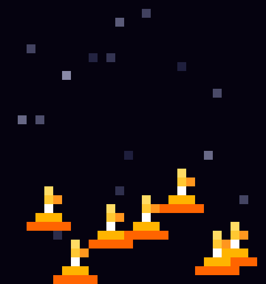
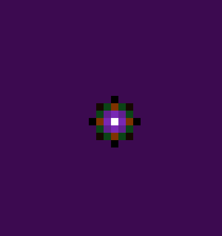
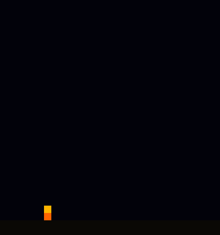
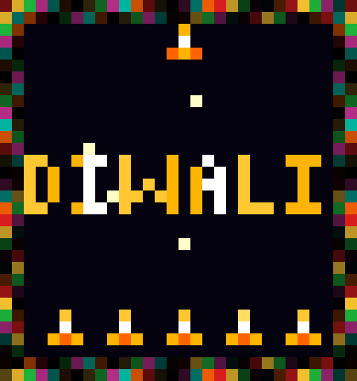
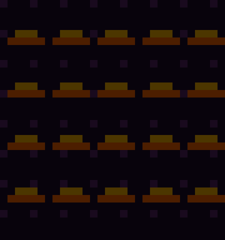
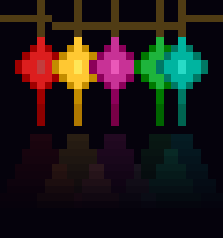

# Govee Curtain Lights Pro — Diwali Animations 🪔🎆

Generate Diwali-themed animated GIFs for the **Govee Curtain Lights Pro (H70B6)**.

All animations are pixel-perfect for the **30 × 32 RGBIC LED grid** (960 LEDs) and optimized to stay well under Govee's 700 KB GIF upload limit.


## Animations Included

| # | Animation | Description | Size |
|---|-----------|-------------|------|
| 1 | 🕯️ Floating Diyas | Oil lamps rising gently against a starlit sky | 7 KB |
| 2 | 🌸 Rangoli Mandala | Expanding colorful rangoli with 8-fold symmetry | 8 KB |
| 3 | 🎆 Fireworks Burst | Multicolor fireworks launching and bursting | 6 KB |
| 4 | ✨ DIWALI Text | Golden "DIWALI" text with twinkling border & diyas | 21 KB |
| 5 | 🔥 Diya Grid Wave | Wave of light sweeping across a grid of diyas | 10 KB |
| 6 | 🏮 Hanging Lanterns | Colorful swaying kandils with glowing light pools | 25 KB |
| 7 | 🪔🎆 Diya + Fireworks | Large flickering diya with fireworks popping around it | 31 KB |

## Requirements

- Python 3.10+
- [Pillow](https://pillow.readthedocs.io/) (Python Imaging Library)

## Installation

```bash
# Clone the repo
git clone https://github.com/dhyanesh/randomdev.git
cd randomdev/govee

# Create a virtual environment (optional but recommended)
python3 -m venv .venv
source .venv/bin/activate

# Install dependencies
pip install -r requirements.txt
```

## Usage

### Generate all 6 base animations

```bash
python generate_diwali_gifs.py
```

### Generate the Diya + Fireworks animation

```bash
python generate_diya_fireworks.py
```

Both scripts output files to the `diwali_gifs/` directory:

- `*_native.gif` — **30×32 px**, ready to upload to the Govee Home app
- `*_preview.gif` — **450×480 px** scaled-up preview for viewing on screen

### Upload to Govee Curtain Lights Pro

1. Open the **Govee Home** app on your phone
2. Select your **Curtain Lights Pro** device
3. Navigate to **DIY → GIF Upload** (or **Pixel Art**)
4. Upload any of the `*_native.gif` files
5. The 30×32 pixel GIF maps directly to the LED grid — no resizing needed

## Device Specs

| Property | Value |
|----------|-------|
| Model | Govee Curtain Lights Pro (H70B6) |
| LED Grid | 30 columns × 32 rows |
| Total LEDs | 960 RGBIC |
| Refresh Rate | 30 Hz |
| Max GIF Size | ~700 KB |
| Supported Formats | GIF, PNG, JPG |

## Customization

Both scripts are easy to modify:

- **Colors** — Edit the color constants at the top of each file
- **Speed** — Change `duration` parameter in `save_gif()` (milliseconds per frame)
- **Firework density** — Add/remove entries in the `spawn_times` list
- **Flame behavior** — Tweak the sine wave parameters in `draw_large_diya()`

## Screenshots

| Floating Diyas | Rangoli Mandala | Fireworks |
|:-:|:-:|:-:|
|  |  |  |

| DIWALI Text | Diya Wave | Hanging Lanterns |
|:-:|:-:|:-:|
|  |  |  |

## License

MIT
